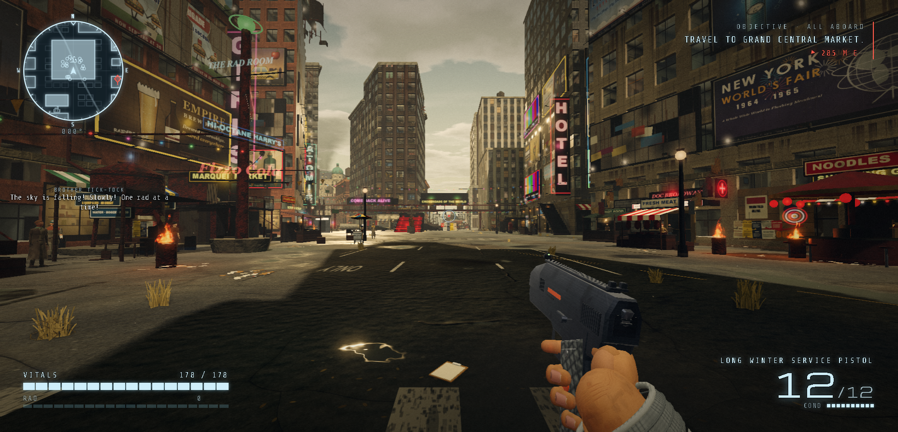

# NEW RAD CITY — offline mirror

Full mirror of **NEW RAD CITY** (https://newrad.city/play) — an open-world
browser city game in the style of a retro-3D Grand Theft Auto: a first-person
city of districts, traffic, weapons, quests and story radio, built directly on
three.js.

Source: https://newrad.city/play



## Stack

- **Single-document three.js game, served at the route `/play`** — the site is
  a Netlify deploy holding `play.html`; Netlify's pretty-URL routing serves it
  at `/play` (200, byte-identical to `/play.html`; `/play/` 301-redirects to
  `/play`). The mirror captures the document as `play.html` and reproduces the
  route with `tools/serve.mjs` (plain `npx serve .` answers 404 for `/play`).
- **~21.5 MiB of inline code in 630 blocks** — the build inlines every source
  module as its own `<script>` block, each opening with its
  `/* src/<dir>/<file>.js */` banner (629 modules + one `window.G_BUILD`
  stamp). The code is **unminified, hand-formatted project source** — module
  names, comments and structure all survive in the capture.
- **three.js stays a CDN script** — `https://cdn.jsdelivr.net/npm/three@0.158.0/build/three.min.js`
  is a cross-origin `<script src>` (classic script, global `THREE`). It is
  never backfilled into the capture (socker precedent, PLAN §1), so the mirror
  needs network access for the engine — recorded external.
- **Google Fonts stay CDN** — six families (`Michroma`, `Share Tech Mono`,
  `VT323`, `Oswald`, `Special Elite`, `Major Mono Display`) load from
  `fonts.googleapis.com` / `fonts.gstatic.com`; recorded external, never
  backfilled.
- **Procedural everything else** — textures (`src/textures/*`), sound effects,
  voices, music and radio (`src/sound/*`) are generated in code; the runtime
  closure scan and the opencli network log over a served session find **no
  same-origin asset fetches at all**.
- **Netlify infrastructure request** — the edge injects
  `<script async id="netlify-rum-container" src="/.netlify/scripts/rum">` into
  the served document; that same-origin RUM beacon is captured byte-exact at
  `.netlify/scripts/rum` (11,141 B, deterministic across fetches).
- **Players' bug reports are backend** — "Report a Bug" POSTs multipart to
  Netlify's form endpoint (`fetch('/', {method:'POST'})`); a static mirror
  cannot serve that backend (documented gap; every gameplay feature is local).

## What this is

NEW RAD CITY (newrad.city/play) — capture-class mirror. The origin is a
Netlify deploy whose `/play` route serves one 22,667,970 B document carrying
the whole game: 630 inline `<script>` blocks (22,515,466 B — the project's own
single-file build, every `src/…` module inlined with its banner), 12 inline
`<style>` blocks (139,891 B) and a small UI markup shell (divs, SVG, canvas
elements). Captured whole, byte-exact under `.upstream/manifest.json`:
**2 files, 22,679,111 bytes** — the entry document (`play.html`) and the
Netlify RUM beacon (`.netlify/scripts/rum`, 11,141 B). The build stamp is
`window.G_BUILD={"hash": "f1f0628", "time": "2026-10-07 18:36"}`.

The runtime closure was scanned statically (`tools/capture.mjs --check` →
1 reference group, 0 unresolved) and cross-checked against an opencli browser
network log recorded on loopback with the logger attached before navigation and
left running through the whole session — document load, city build, NEW GAME,
the intro and first-person play (`docs/boot-network-2026-10-13.json`, 11
requests): **0 new same-origin requests beyond the capture** — `/play` and
`/.netlify/scripts/rum` (11,141 B, exact) are the only same-origin requests.
Off-origin: the two Google Fonts stylesheets + five `fonts.gstatic.com` font
files + the jsdelivr three.js — all recorded external. One in-page `blob:` URL
(a worker built from a Blob in the game code). The only recorded 404 is the
browser-implicit `favicon.ico`.

## Layout

- `play.html` — the capture of the served `/play` document (disk name = the
  deploy's own file name)
- `.netlify/scripts/rum` — the same-origin Netlify RUM beacon the document
  references
- `.upstream/manifest.json` — sha256 + bytes for every captured file (Gen-A)
- `_mirror-report.json` — crawl record: request count, captured paths, the
  `/play` route aliases, the recorded 404 gap, external references
- `readable/` — prettified derived layer (pinned prettier 3.9.6): 630
  `play-inline-N.pretty.js` script twins + 12 `play-inline-N.pretty.css` style
  twins + `netlify-rum.pretty.js` (643 files, 856,166 lines), and
  `index-inline-map.json` (byte range + sha256 + module banner for every
  inline block)
- `src/` + `split-spec.json` — 2,945 statement-aligned slices of the inline
  modules (4,626 spec sections: 2,945 slices, 1,669 skipped non-standalone,
  12 wholeFile stylesheets) with the recorded derivation spec
- `docs/` — `cover.png` (gameplay), `boot-2026-10-13.png` (boot evidence),
  `boot-network-2026-10-13.json` (the opencli network log)
- `tools/capture.mjs` — byte-exact capture + runtime-closure fetch (`--check`
  residual closure audit, `--dry-run` scanner candidates)
- `tools/derive.mjs` — rebuild `readable/` + `src/` + `split-spec.json`
- `tools/pinned-prettier.cjs` — the one place this mirror resolves its pinned
  prettier 3.9.6: the vendored copy below, `$PRETTIER_MJS` as an override, a
  local `node_modules` last; any other version is refused
- `tools/vendor/prettier/` — prettier 3.9.6 (module API) vendored into this
  mirror so re-derivation never reaches into another mirror's tree (19 files;
  see `VENDOR-README.md`)
- `tools/verify.mjs` — re-hash the capture against the manifest
- `tools/update.mjs` — read-only drift probe against the live origin
- `tools/audit.js` — integrity gate for the derived layers (`AUDIT PASS`)
- `tools/check-links.mjs` — link gate: every scope of the derived layer exports
  only names the layer declares (`node tools/check-links.mjs`)
- `tools/net-crosscheck.mjs` — compare an opencli network log against the
  manifest (dynamic closure check)
- `tools/serve.mjs` — static server reproducing the origin's served paths
  (`/play` → `play.html`, `/play.html` → `play.html`, `/play/` → 301 `/play`)

## Assets

The build is a single document: the art is **procedural** and the code is the
payload. What the repo carries:

- **code (the payload)** — 630 inline `<script>` blocks in `play.html`
  (22,515,466 B): 629 `/* src/<dir>/<file>.js */` modules (core, textures,
  sound, atmosphere, map, landmarks_a/b, poi_* ×20+, props, characters,
  ambient_life, combat, weapons, rpg, quests, arcade, lair, ui_hud,
  ui_interact, render_*, …) plus the `G_BUILD` stamp. In-file representation:
  raw text, unminified, one block per module, load order = document order.
- **styles** — 12 inline `<style>` blocks (139,891 B), each carrying its own
  `/* src/<...>.css */` banner (HUD, weapons scope, radio, menus, POI
  readouts…). In-file representation: raw CSS text.
- **images** — none as files. All art is generated at runtime on canvases
  (`src/textures/*` paint facades, signs, brands, ads, story art; the city,
  vehicles and props are procedural three.js geometry). The only in-file image
  data is an SVG `data:` URI used as a menu grain texture inside a style block.
- **audio** — none as files. `src/sound/*` synthesises every weapon, voice,
  UI and world sound plus the music/radio beds with WebAudio; the network log
  confirms zero audio requests.
- **models** — none as files: procedural three.js geometry built in code.
- **fonts** — none captured: the six Google Fonts families stay external CDN
  references (never backfilled).
- **data** — none as files: layout, POI, quest and story data live inside the
  inline modules (e.g. `src/core/layout.js` is the world-layout single source
  of truth).

## Run

The origin serves the game at the route `/play`; reproduce that exactly with
the mirror's own server (off-the-shelf static servers do not map the
extensionless route):

```
node tools/serve.mjs 8080
# then open http://127.0.0.1:8080/play
```

The game is fully client-side except the two CDN dependencies that stay CDN
(three.js + Google Fonts), so with network access the mirror plays exactly as
upstream from the single route. The bug-reporter's submit POSTs to Netlify's
form backend — a backend interaction a static mirror cannot serve; every other
feature is local. The game needs WebGL. It builds the city procedurally on the
main thread at load (minutes on software rendering); the loading screen shows
per-module progress until "Ready.".

## Verify

```
node tools/verify.mjs                 # re-hash the capture → 2 files checked, 0 problems
node tools/audit.js                   # derived-layer integrity gate → AUDIT PASS
node tools/capture.mjs --check        # residual closure audit → 0 new unresolved
node tools/net-crosscheck.mjs docs/boot-network-2026-10-13.json   # dynamic closure check
node tools/check-exports.mjs                                      # the derived layer still exports every public name
node tools/check-links.mjs                                        # every scope of the derived layer exports only names the layer declares
```

`check-links.mjs` guards the one class the export-name gate cannot see: a
layer file whose export statement names a binding the layer never declares is
a hard SyntaxError at link time, and the file cannot be imported at all. The
layer here is a CLASSIC-SCRIPT layer — 2945 slices cut from 631 readable
modules, each the body of an IIFE — and it carries no export statement
anywhere, so the class is structurally absent today and the gate says so
(631 scopes, 0 export tables). It is deployed because it is this mirror's only
watch on the export side of the layer, and it fires the moment a slice carries
an export table that names a binding the module does not declare.


## Boot test (2026-10-27)

- Entry: `http://127.0.0.1:4886/play` served by `tools/serve.mjs` with the network blocked (`MAP * 127.0.0.1`).
- Outcome: **blocked** — a blank white page with no text and no canvas: three.js is a CDN dependency, so offline `THREE` is undefined and every module that touches it throws.
- Evidence: body 0 chars; canvas none; 127 console errors; 1 failed same-origin request, 3 blocked cross-origin; screenshot taken and deleted (blank, so not evidence).
- Gaps seen: `/favicon.ico` 404 (the existing recorded gap); no other same-origin 404.

The boot confirms the documented "CDN dependencies stay CDN" structure: the immediate first-party load (`/play` 200, `/.netlify/scripts/rum` 200) is complete, and the only blocker is the external three.js script (`cdn.jsdelivr.net`, plus two Google Fonts stylesheets) that the capture deliberately does not backfill. Offline playability is therefore refuted; the with-network-playable claim is untouched.

## Boot test (2026-10-29 refresh)

- Entry: `http://127.0.0.1:4783/play` served by `tools/serve.mjs`, headless
  Chrome 156 with every host resolved to loopback
  (`--host-resolver-rules="MAP * 127.0.0.1"`), session label
  `boot-newrad-refresh`.
- Outcome: **blocked**, identical to 2026-10-27 — blank white page: no visible
  text, no canvas.
- Evidence (CDP): `THREE: undefined`, `canvas: 0`, body innerText `""`;
  127 `TypeError` exceptions (`Cannot read properties of undefined (reading
  'Vector3' / 'Material' / 'Color' / 'noise')`), 3 failed cross-origin
  requests (`ERR_CONNECTION_REFUSED`: jsdelivr three.js + the two Google Fonts
  stylesheets).
- Same-origin: `/play` 200 (22,667,970 B), `/.netlify/scripts/rum` 200
  (11,141 B) — the capture is complete; `/favicon.ico` 404 (the recorded gap).
- Screenshot: taken and **not saved** — the frame was uniformly blank white,
  so it is not evidence. There is no `docs/boot-2026-10-29-refresh.png`.

## Updating from upstream

```
node tools/update.mjs     # read-only drift probe: what changed upstream
```

The probe fetches the entry from the **route** `/play` (route-named, no
`.html` suffix — the template's normalized branch) and compares it normalized;
other captured files are probed by sha256. It never rewrites the capture — a
mirror is a point-in-time snapshot. Refreshing means re-fetching into a clean
tree (`node tools/capture.mjs`), re-cutting the manifest, and re-deriving
`readable/` + `src/` from the new document with `node tools/derive.mjs`.

### 2026-10-13 capture + readable/src derivation

- **Capture** (byte-exact, nothing edited): 2 files, 22,679,117 bytes —
  `play.html` (22,667,976 B; the served `/play` document: 630 inline scripts
  22,515,466 B + 12 inline styles 139,891 B + UI markup) and
  `.netlify/scripts/rum` (11,141 B). Route forms verified live: `/play` 200
  (22,667,976 B), `/play.html` 200 byte-identical, `/play/` 301 → `/play`,
  `/favicon.ico` 404 (recorded gap). Closure driven to a fixpoint by
  `tools/capture.mjs` (5 requests): the static scan finds exactly one
  same-origin reference besides the document itself — the Netlify RUM beacon —
  and it is captured; the game's own code references no same-origin assets at
  all (procedural art/audio), so the capture is complete.
- **Dynamic closure cross-check** — the mirror was served on loopback
  (`tools/serve.mjs`) and opened in an opencli browser session with
  `network --all --follow` attached before navigation and left running across
  the whole session (document load → title → NEW GAME → intro → first-person
  play); the recorded log (`docs/boot-network-2026-10-13.json`, 11 entries)
  contains **zero same-origin requests that are not captured files**: `/play`
  (200) and `/.netlify/scripts/rum` (200, 11,141 B — the captured size).
  Off-origin: `fonts.googleapis.com` ×2, `fonts.gstatic.com` ×5 (font files),
  `cdn.jsdelivr.net` ×1 (three.js) — all recorded external; one in-page
  `blob:` worker URL. `tools/net-crosscheck.mjs` → `0 new missing`. The play
  session made no further network requests at all (the log stops growing once
  the document is loaded).
- **readable/** — pinned prettier 3.9.6 (module API, default options,
  format-to-fixed-point: 640 sources stabilize on the second pass, 3 on the
  third; the per-source `prettyPasses` count is recorded; never the CLI — it
  respects `.gitignore` and can silently echo its input) rendered **643 twins,
  856,166 lines / 26,997,503 B**: `readable/play-inline-1..630.pretty.js`
  (the inline script blocks in document order — every block provably NOT a
  byte copy of its capture block), `readable/play-inline-1..12.pretty.css`
  (the inline style blocks) and `readable/netlify-rum.pretty.js` (the
  extensionless captured beacon). 640 of the twins carry their capture block's
  own `/* src/… */` module banner (629 script modules + 11 style modules) and
  `readable/index-inline-map.json` records every block's exact byte range +
  sha256 + banner.
- **src/** — **2,945 statement-aligned slices** (`src/play-inline-N-MM.js`,
  1..MM per module, plus `src/netlify-rum-NN.js`) in 4,626 recorded sections:
  2,945/2,945 parse standalone (`node --input-type=module --check -`) and
  round-trip byte-exact to their recorded readable line ranges. The module
  IIFE is unwrapped and slices are cut only at its body's top-level statement
  boundaries (~250-350 line windows, median 284); oversized single
  declarations stay whole (410 slices over 350 lines, largest 2,820 —
  procedural city data tables). The **1,669 skipped sections** are the
  non-standalone parts: each module's IIFE wrapper head/tail and its top-level
  `return` guard clauses (indexed with first/last line re-verification, never
  sliced). The entry point `split-spec.defaultFile` is the first slice of
  `src/core/layout.js`.
- **Stylesheet rule** — the 12 inline `<style>` blocks are wholeFile sections,
  never sliced. **notRendered** — 0 records: nothing non-code was captured.
- **Gates (verbatim)**: `node tools/verify.mjs` → `2 files checked, 0
  problems`; `node tools/audit.js` → `AUDIT PASS — 4626 spec sections
  (2945/2945 src↔pretty round-trips byte-exact, 643/643 pretty sources tiled
  contiguously, 1669/1669 skipped non-standalone sections re-verified
  textually, 2945/2945 src slices + 631/631 readable/*.pretty.js parse
  standalone (node --input-type=module --check -), 643/643 pretties provably
  distinct from their capture source, 1681 index-only wholeFile/skipped
  sections carry no src file, 642 inline content block(s) with twins +
  index-inline-map.json, 0 notRendered payload records (all captured payloads
  covered), 0/0 imports resolve inside the capture (0 whitelisted machinery),
  643/643 pretties re-render byte-exact under pinned prettier 3.9.6
  (format-to-fixed-point), shape guards held, capture manifest free of derived
  layers)`; `node tools/capture.mjs --check` → `0 new unresolved`;
  `node tools/net-crosscheck.mjs docs/boot-network-2026-10-13.json` → `0 new
  missing`; `node tools/update.mjs` → `up to date: 2 captured files identical
  upstream`; independent 3-slice check → 3/3 byte-exact + header-exact + parse
  standalone.
- **Boot + cover** — the mirror was served on loopback with `tools/serve.mjs`
  and opened through opencli. Boot: the loader screen rendered and the game
  built the city through its per-module loading screen (48 init groups) to the
  title screen — `docs/boot-2026-10-13.png` shows the rendered skyline behind
  the NEW RAD CITY title. Play: NEW GAME → the 1967 intro cinematic (SPACE/
  ENTER/click) → the hero wakes in the LONG WINTER cryo prep room in first
  person (VITALS 178/178, RAD 0, minimap, objective HUD, the player's hands on
  the pistol); the session walked the streets (Times Square/"The Neon",
  discovery banners, ambient NPC dialogue) and `docs/cover.png` is gameplay
  from that session — the Times Square approach with the LONG WINTER SERVICE
  PISTOL drawn, the full HUD and the walking viewmodel. Note on the capture
  environment: the page was driven through synthetic input, which cannot hold
  Chrome pointer lock, so the session set the game's own `G.SHOT` screenshot
  flag (the game's documented `?shot=` mode flag, `src/core/engine.js`) to
  suppress its pointer-lock resume veil and accept the synthetic mouse-look
  deltas; the world, HUD, physics and walking are the game's own. Serve probe:
  `/play` and `/play.html` 200 text/html at 22,667,976 B,
  `/.netlify/scripts/rum` 200 text/javascript at 11,141 B, `/play/` 301 →
  `/play`, unknown paths 404; listener PID killed and the port proven closed
  (`netstat` shows no listener and the port refuses connections).
- **§0.4 fork-over-mirror checked 2026-10-13**: the project has **no own
  public repo** — the captured document carries no github/gitlab/bitbucket
  reference at all (its only outbound URLs are the two CDN dependencies and
  the author's `x.com/chrisfirst` / `instagram.com/chrisfirstt` links), GitHub
  repository search for "newrad-city" returns only this mirror and for
  "new rad city" + game returns 0 repositories, and the only code-search hit
  for "newrad.city" is an unrelated list file in `dontcrash/NRD`. The mirror
  stands.
- **Open task (PLAN §5)**: identifiers in `src/` are the capture's own names.
  The modules are unminified project source, so meaningful names survive the
  derivation; a deep identifier rename campaign has not been run. The
  bug-report submit path is a documented backend gap. Rebuild the derived
  layers any time with `node tools/derive.mjs`.

### 2026-10-29 refresh (fleet drift probe: 1 of 2 files changed)

- **Probe** — `node tools/update.mjs` → `DRIFT: 1 changed, 0 live-missing (of 2
  captured)`: `play.html` only. `.netlify/scripts/rum` (11,141 B) unchanged.
- **What actually changed (6 bytes)** — the document shrank 22,667,976 →
  22,667,970 B. The game is untouched: the build stamp is the same
  `window.G_BUILD={"hash": "f1f0628", "time": "2026-10-07 18:36"}`, all 630
  inline scripts (22,515,466 B) and 12 inline styles (139,891 B) are identical,
  and the whole diff is the Netlify **edge-injected** `netlify-rum-container`
  tag: its `data-netlify-cwv-token` JWT payload changed (`"iss":"netlify"` →
  `"issuer":"nfserver"`) and the tag/blank-line ordering shifted. That token is
  a rotating per-response/per-deploy edge value, not project content — hence
  `update.mjs` (which normalizes nonces/UUIDs/CF tokens but not this JWT)
  reports it as drift.
- **Refresh** — old `play.html` copied to `legacy/2026-10-29/play.html`
  (sha256 `6474efc…a4ef5`) before overwriting; `node tools/capture.mjs` then
  re-fetched to the closure fixpoint (`round 2: 0 new references`, 5 requests,
  2 files, 22,679,111 B, 1 recorded 404 `favicon.ico`, 6 external).
  `.upstream/manifest.json` and `_mirror-report.json` re-cut: `play.html`
  now 22,667,970 B / sha256 recorded. No file went missing upstream.
- **Re-derive** (`node tools/derive.mjs`, after the capture) — `readable/` 643
  twins + `src/` 2,945 slices + `readable/index-inline-map.json` +
  `split-spec.json` regenerated: `643 readable file(s), 2945 src slices
  (2945/2945 parse standalone, 2945/2945 round-trip byte-exact), 1669 skipped,
  12 wholeFile, 631 pretty js parse clean, 0 notRendered, 0 orphan(s) pruned —
  self-check clean`. Because only the edge tag changed, **every derived file
  came out byte-identical to the previous derivation** (`git status` showed no
  change under `readable/`, `src/` or `split-spec.json`), so there was nothing
  superseded to archive in `legacy/`.
- **Gates (verbatim)** — `node tools/verify.mjs` → `2 files checked, 0
  problems`; `node tools/audit.js` → `AUDIT PASS` (4626 sections, 2945/2945
  round-trips, 643/643 pretties, 631/631 parse, 0 imports); `node
  tools/check-exports.mjs` → `0 export table(s) checked` / `no public export
  name lost`; `node tools/check-links.mjs` → `631 scopes … 0 export tables …
  every export table names a binding the layer declares: YES`; `node
  tools/capture.mjs --check` → `1 reference group(s), 0 unresolved (0 new vs
  _mirror-report.json)`, 6 external; `node
  tools/net-crosscheck.mjs docs/boot-network-2026-10-13.json` → `0 new
  missing`; `node tools/update.mjs` → `up to date: 2 captured files identical
  upstream`.
- **Boot (offline)** — see "Boot test (2026-10-29 refresh)" above: still
  **blocked**, unchanged conclusion.
- Prior records above are kept as written for the 2026-10-13 capture.

## Mirror conventions

- **Capture layer** — the captured files are byte-exact copies of what the
  origin served; nothing in them is edited. `.gitattributes` pins `* -text` so
  git never normalizes EOLs.
- **CDN dependencies stay CDN** — three.js (jsdelivr) and the Google Fonts
  stylesheets/font origins are recorded as external references and are never
  backfilled into the capture (PLAN §1, socker precedent).
- **Readable layer** — `readable/` is derived (prettified) and never shipped
  to a browser; it exists so the single-file build can actually be read.
- **Provenance** — `.upstream/manifest.json` records sha256 for each captured
  artifact, and `tools/verify.mjs` re-checks it; `_mirror-report.json` is the
  crawl record.
- **Drift** — `tools/update.mjs` is read-only: it reports what changed
  upstream and never rewrites the capture.

## Fleet status

<!-- mirror-status:start — feeds _standard/REPO-INDEX.md. Update ONLY your own mirror's block; never edit the shared index (PLAN §8). Rebuild: node _standard/build-index.mjs -->
<!-- cols: cls=classification · ver=verify 0 problems · upd=drift probe · man=manifest · rdbl=readable re-derived · src=reversed src · boot=boot test · top=offline-mirror topic · tag=backup tag · staged=staged not committed -->
| # | repo | cls | ver | upd | man | rdbl | src | boot | top | tag | staged |
|---|---|---|---|---|---|---|---|---|---|---|---|
| 303 | newrad-city | mirror | ✓ | ✓ | ✓ | ✓ | ✓ | ✓ | ✓ | — | — |
<!-- mirror-status:end -->
